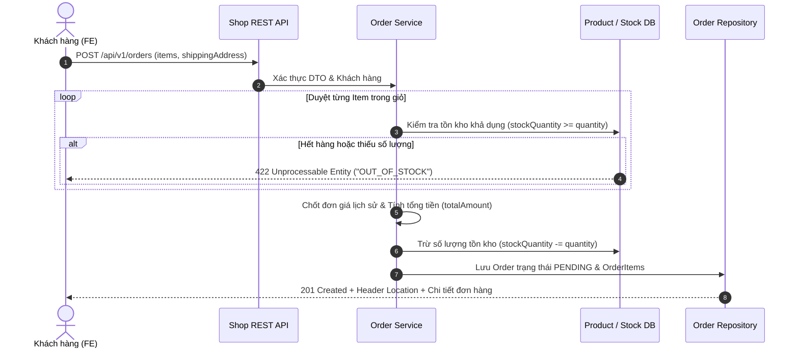
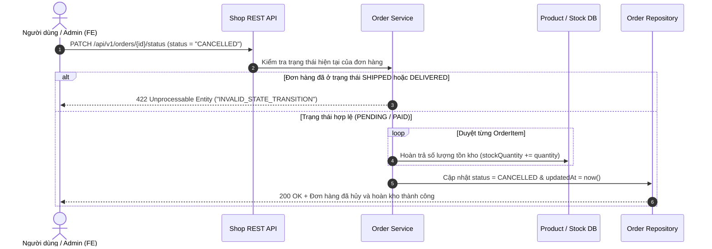

# TÀI LIỆU PHÂN TÍCH YÊU CẦU NGHIỆP VỤ (BA ENTERPRISE SPECIFICATION)
## DỰ ÁN: SHOP RESTFUL API - MÔ HÌNH THỰC THỂ DOANH NGHIỆP, USER STORIES & FAIL-FAST
*(Tuân thủ 100% chuẩn mực API-First, Đề bài Bài tập lớn Fullstack & Rubric Đánh giá)*

---

### 1. Bức Tranh Tổng Thể & Kiến Trúc Nghiệp Vụ Doanh Nghiệp
Hệ thống **Shop API** được thiết kế phục vụ nền tảng thương mại điện tử chuyên nghiệp theo quy trình **API-First Development** kết hợp **Spring Boot 3.x / JPA**. Toàn bộ hợp đồng được xác lập chặt chẽ làm **Single Source of Truth** để khi chuyển giao sang Backend, đội ngũ kỹ sư kế thừa Mock Server, UI Prototype và bộ Test Suite là có thể ánh xạ sang MySQL Entity 1-1.

---

### 2. Mô Hình Thực Thể Hoàn Chỉnh (Enterprise Entity Model)
Tất cả các thực thể đều bắt buộc có trường thời gian (`createdAt`, `updatedAt`) chuẩn **ISO-8601 UTC** để phục vụ hiển thị UI, lọc dữ liệu và kiểm toán (Audit Trail):

1. **Danh Mục Sản Phẩm (`Category`)**:
   - `id` (BIGINT, PK, Auto Increment) | `name` (VARCHAR(100), Unique, Not Null) | `code` (VARCHAR(50), Unique, Not Null)
   - `description` (VARCHAR(500)) | `status` (ENUM: ACTIVE, INACTIVE) | `createdAt`, `updatedAt` (ISO-8601 UTC)
   - *Quan hệ*: $1:N$ với `Product`.

2. **Sản Phẩm (`Product`)**:
   - `id` (BIGINT, PK, Auto Increment) | `categoryId` (BIGINT, FK, Not Null) | `name` (VARCHAR(150), Not Null)
   - `sku` (VARCHAR(50), Unique, Not Null, Regex: `^[A-Z0-9_-]{3,30}$`) | `price` (DECIMAL(12,2), $\ge 1,000$)
   - `stockQuantity` (INT, Not Null, $\ge 0$) | `imageUrl` (VARCHAR(500), URI - Hỗ trợ link web hoặc đường dẫn file tải lên từ thư mục máy tính)
   - `description` (TEXT) | `status` (ENUM: ACTIVE, INACTIVE, OUT_OF_STOCK) | `createdAt`, `updatedAt` (ISO-8601 UTC)

3. **Người Dùng & Khách Hàng (`Customer / User`)**:
   - `id` (BIGINT, PK, Auto Increment) | `email` (VARCHAR(100), Unique, Not Null, Valid Email)
   - `password` (VARCHAR(100), Mã hóa BCrypt khi sang DB thật) | `fullName` (VARCHAR(100), Min 2 ký tự)
   - `phone` (VARCHAR(15), Regex: 10-11 số) | `address` (VARCHAR(255), Min 5 ký tự) | `avatarUrl` (VARCHAR(500))
   - `role` (ENUM: `CUSTOMER`, `STAFF`, `ADMIN`) | `status` (ACTIVE, INACTIVE, LOCKED) | `createdAt`, `updatedAt` (ISO-8601 UTC)

4. **Đơn Hàng (`Order`)**:
   - `id` (BIGINT, PK) | `customerId` (BIGINT, FK, Not Null) | `totalAmount` (DECIMAL(14,2), Not Null)
   - `status` (ENUM: `PENDING`, `PAID`, `SHIPPED`, `CANCELLED` - hỗ trợ mở rộng `CONFIRMED`, `DELIVERED`)
   - `shippingAddress` (VARCHAR(255), Not Null) | `createdAt`, `updatedAt` (ISO-8601 UTC)

5. **Chi Tiết Đơn Hàng (`OrderItem`)**:
   - `id` (BIGINT, PK) | `orderId` (BIGINT, FK) | `productId` (BIGINT, FK) | `productName` (VARCHAR(150))
   - `unitPrice` (DECIMAL(12,2), Not Null - **Bảo toàn đơn giá lịch sử**) | `quantity` (INT, $\ge 1$) | `subTotal` (DECIMAL(14,2)) | `createdAt` (ISO-8601 UTC)

---

### 3. Hệ Thống User Stories Doanh Nghiệp (Theo 3 Module Chuẩn Rubric)

#### Module 1: Khách hàng (Customers)
* **US-01 (Đăng ký tài khoản)**: Là khách hàng mới, tôi muốn đăng ký tài khoản với Email và Số điện thoại hợp lệ để có thông tin định danh mua sắm trên hệ thống.
* **US-02 (Đăng nhập & Xác thực)**: Là người dùng, tôi muốn đăng nhập bằng Email và Mật khẩu để nhận JWT Token nhằm thực hiện các giao dịch bảo mật theo phân quyền (RBAC).
* **US-03 (Quản lý hồ sơ & Lịch sử)**: Là khách hàng, tôi muốn xem/cập nhật thông tin cá nhân và xem toàn bộ lịch sử đơn hàng kèm trạng thái và mốc thời gian đặt.

#### Module 2: Danh mục & Sản phẩm (Categories & Products)
* **US-04 (Duyệt & Tìm kiếm hàng hóa)**: Là khách hàng, tôi muốn xem danh sách sản phẩm có phân trang, lọc theo danh mục, lọc theo khoảng giá và tìm kiếm theo tên/SKU để nhanh chóng tìm thấy món hàng mong muốn.
* **US-05 (Quản lý sản phẩm & Kho hàng)**: Là quản trị viên (Admin/Staff), tôi muốn quản lý danh mục và thêm/sửa sản phẩm (chọn ảnh từ thư mục máy tính hoặc nhập URL, chỉnh giá, cập nhật số lượng tồn kho) để đảm bảo dữ liệu kho luôn chính xác.

#### Module 3: Giỏ hàng & Đặt hàng (Cart & Orders)
* **US-06 (Quản lý giỏ hàng động)**: Là khách hàng, tôi muốn thêm/sửa/xóa sản phẩm trong giỏ hàng và xem tổng tiền tạm tính cập nhật theo thời gian thực.
* **US-07 (Quy trình Đặt hàng Checkout)**: Là khách hàng, tôi muốn bấm Đặt hàng để hệ thống tự động kiểm tra tồn kho, tính tổng tiền, tạo đơn hàng trạng thái `PENDING` và trừ tồn kho trong CSDL.
* **US-08 (Vòng đời đơn hàng & Hủy đơn hoàn kho)**: Là người quản lý hoặc khách hàng, tôi muốn cập nhật tiến độ đơn (`PENDING` $\rightarrow$ `PAID` $\rightarrow$ `SHIPPED`), hoặc hủy đơn (`CANCELLED`) để hệ thống **tự động hoàn lại số lượng tồn kho**.

---

### 4. Sơ Đồ Luồng Nghiệp Vụ Cốt Lõi (Core Business Workflows)

#### Sơ đồ 1: Luồng Nghiệp Vụ Đặt Hàng (Checkout Flow)

#### Sơ đồ 2: Luồng Nghiệp Vụ Hủy Đơn & Hoàn Tồn Kho (Cancel & Restock Flow)

---

### 5. Quy Tắc Kiểm Soát Nghiệp Vụ & Fail-Fast Chi Tiết
1. **FF-01 (Kiểm soát Tồn kho Fail-Fast)**:
   - Khi đặt hàng, duyệt từng item. Nếu `stockQuantity < quantity`, lập tức ngắt giao dịch và trả về `422 Unprocessable Entity`, mã `OUT_OF_STOCK`.
2. **FF-02 (Ràng buộc Khóa ngoại Danh mục)**:
   - Tạo/sửa sản phẩm: `categoryId` bắt buộc tồn tại trong CSDL $\rightarrow$ nếu không có trả về `404 CATEGORY_NOT_FOUND`.
   - Cấm xóa Danh mục nếu đang có Sản phẩm liên kết $\rightarrow$ trả về `409 CATEGORY_IN_USE`.
3. **FF-03 (Bảo toàn Giá Lịch sử)**:
   - `OrderItem.unitPrice` được chốt tại thời điểm đặt hàng. Biến động giá sản phẩm tương lai không ảnh hưởng đến đơn cũ.
4. **FF-04 (Vòng đời Đơn hàng & Quy tắc Hoàn tồn kho)**:
   - Chuỗi trạng thái chuẩn: `PENDING` (Chờ xử lý) $\rightarrow$ `PAID` (Đã thanh toán) $\rightarrow$ `SHIPPED` (Đã giao) hoặc `CANCELLED` (Đã hủy).
   - Đơn đã `SHIPPED` hoặc `CANCELLED` là trạng thái kết thúc (Terminal State) $\rightarrow$ cấm đổi trạng thái tiếp (`422 INVALID_STATE_TRANSITION`).
   - **Bắt buộc**: Khi đơn hàng chuyển sang `CANCELLED`, hệ thống tự động **hoàn lại số lượng tồn kho** cho từng sản phẩm trong đơn.
5. **FF-05 (Bảo vệ Định danh Duy nhất)**:
   - Trùng Email $\rightarrow$ `409 EMAIL_ALREADY_EXISTS`. Trùng SKU $\rightarrow$ `409 SKU_ALREADY_EXISTS`. Trùng Code danh mục $\rightarrow$ `409 CATEGORY_CODE_EXISTS`.
6. **FF-06 (Quy tắc Audit Date & Bất Biến)**:
   - `createdAt` được gán mốc thời gian tạo và là trường bất biến (`updatable = false`). `updatedAt` tự động cập nhật khi có chỉnh sửa. Định dạng: **ISO-8601 UTC**.
7. **FF-07 (Quy tắc Quản lý Ảnh Đa phương tiện)**:
   - Database lưu chuỗi `imageUrl` (VARCHAR(500)). Giao diện hỗ trợ chọn ảnh từ thư mục máy tính (Upload `multipart/form-data` hoặc Data URI/Base64 preview) hoặc nhập link ảnh trực tiếp.

---

### 6. Ma Trận RESTful Endpoints Toàn Hệ Thống

| Nhóm Tài Nguyên | Method | URI Endpoint | Mã HTTP | Mô Tả Nghiệp Vụ & Dấu Vết Thời Gian |
| :--- | :--- | :--- | :---: | :--- |
| **Auth** | `POST` | `/api/v1/auth/login` | 200, 400, 401 | Đăng nhập lấy JWT Bearer Token |
| | `POST` | `/api/v1/auth/register` | 201, 400, 409 | Đăng ký tài khoản (khởi tạo `createdAt`, validate email/phone) |
| | `GET` | `/api/v1/auth/me` | 200, 401 | Lấy thông tin tài khoản hiện tại |
| **Categories** | `GET` | `/api/v1/categories` | 200 | Lấy danh sách danh mục (hỗ trợ sort theo `createdAt`) |
| | `POST` | `/api/v1/categories` | 201, 400, 409 | Thêm danh mục mới (Admin/Staff) |
| | `GET` | `/api/v1/categories/{id}` | 200, 404 | Xem chi tiết danh mục |
| | `PUT` | `/api/v1/categories/{id}` | 200, 400, 404 | Chỉnh sửa danh mục (cập nhật `updatedAt`) |
| | `DELETE`| `/api/v1/categories/{id}`| 204, 404, 409 | Xóa danh mục (Fail-Fast nếu có hàng) |
| **Products** | `GET` | `/api/v1/products` | 200, 400 | Lọc theo category, stock, khoảng giá, sort, phân trang |
| | `POST` | `/api/v1/products` | 201, 400, 404, 409 | Thêm sản phẩm mới (chọn ảnh từ thư mục hoặc URL) |
| | `GET` | `/api/v1/products/{id}` | 200, 404 | Chi tiết thông số & tồn kho sản phẩm |
| | `PATCH` | `/api/v1/products/{id}` | 200, 400, 404 | Sửa giá/kho/mô tả/ảnh (cập nhật `updatedAt`) |
| | `DELETE`| `/api/v1/products/{id}` | 204, 404 | Xóa sản phẩm khỏi kho |
| **Customers** | `GET` | `/api/v1/customers` | 200, 400 | Danh sách khách hàng phân trang |
| | `GET` | `/api/v1/customers/{id}` | 200, 404 | Xem hồ sơ khách hàng |
| | `PUT` | `/api/v1/customers/{id}` | 200, 400, 404 | Cập nhật hồ sơ cá nhân (cập nhật `updatedAt`) |
| | `GET` | `/api/v1/customers/{id}/orders` | 200, 404 | Lịch sử đơn hàng của khách hàng theo thời gian |
| **Orders** | `GET` | `/api/v1/orders` | 200, 400 | Danh sách đơn hàng toàn hệ thống |
| | `POST` | `/api/v1/orders` | 201, 400, 404, 422 | Checkout: kiểm tra tồn kho, trừ kho, tạo đơn PENDING |
| | `GET` | `/api/v1/orders/{id}` | 200, 404 | Chi tiết hóa đơn và đơn giá lịch sử |
| | `PATCH` | `/api/v1/orders/{id}/status` | 200, 400, 404, 422 | Đổi trạng thái (PENDING->PAID->SHIPPED), Hủy đơn hoàn kho |
