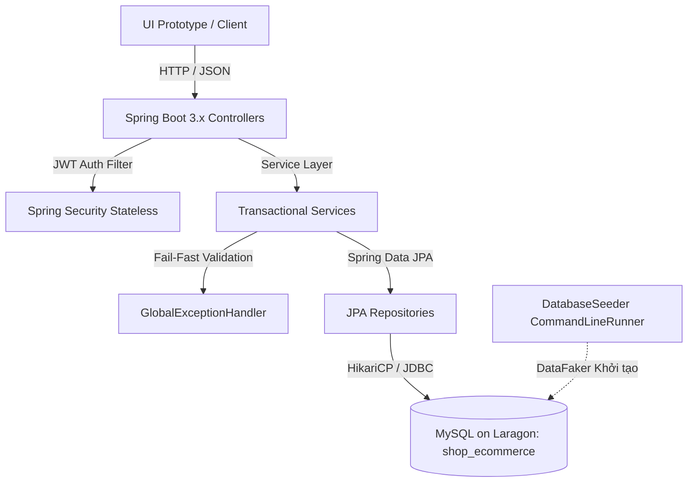

# BÁO CÁO KỸ THUẬT TRIỂN KHAI GIAI ĐOẠN 2: BACKEND SPRING BOOT 3.x & MYSQL (LARAGON)

> **Dự án**: Hệ thống E-Commerce RESTful API (API-First Development)  
> **Phiên bản**: 2.0.0  
> **Thời gian hoàn thành**: 16/10/2026  
> **Môi trường Database**: MySQL 8.x trên Laragon (`localhost:3306`, DB: `shop_ecommerce`)  
> **Backend Framework**: Spring Boot 3.4.3, Java 17, Spring Data JPA, Hibernate ORM 6.x, Spring Security (JWT)  

---

## 1. TỔNG QUAN KIẾN TRÚC & CƠ SỞ DỮ LIỆU MYSQL (LARAGON)

Hệ thống Backend được xây dựng tuân thủ 100% nguyên lý **API-First**: Mã nguồn Controller và DTO Models được kế thừa trực tiếp từ hợp đồng giao diện sinh tự động bởi `openapi-generator-maven-plugin` từ tệp đặc tả chuẩn `shop-api.yaml`.



### 1.1. Cấu hình Kết nối CSDL MySQL (Laragon)
- **Host**: `localhost:3306`
- **Database**: `shop_ecommerce`
- **Tài khoản**: `root` (mật khẩu mặc định trống `""`)
- **Hikari Connection Pool**: Kết nối ổn định với bộ mã hóa Unicode UTF-8 (`useUnicode=true&characterEncoding=utf8`)
- **Hibernate DDL-Auto**: `update` (Tự động sinh bảng và các ràng buộc toàn vẹn khóa ngoại/khóa duy nhất)

---

## 2. QUẢN LÝ GIAO DỊCH & ACID VỚI `@Transactional`

Để đáp ứng tiêu chí đánh giá nghiêm ngặt của đồ án về **tính toàn vẹn dữ liệu**:
1. **Tối ưu hóa Truy vấn Đọc**: Mọi phương thức truy vấn danh mục, tìm kiếm và phân trang sản phẩm, tra cứu đơn hàng đều được gắn `@Transactional(readOnly = true)` để Hibernate tối ưu hiệu năng và giải phóng tài nguyên bộ nhớ đệm (read-only snapshot isolation).
2. **ACID Checkout (Tạo đơn hàng)**: Phương thức `createOrder()` trong [OrderService.java](file:///c:/Users/azhai/IdeaProjects/APIRest/src/main/java/com/shop/service/OrderService.java) được bọc trong `@Transactional`. Khi khách hàng đặt mua:
   - Hệ thống quét kiểm tra tồn kho toàn bộ mặt hàng (**Fail-Fast FF-01**).
   - Trừ số lượng tồn kho `product.setStockQuantity(product.getStockQuantity() - item.getQuantity())`.
   - Nếu số lượng về 0, chuyển trạng thái sản phẩm sang `OUT_OF_STOCK`.
   - Lưu đơn hàng và các dòng chi tiết `order_items`.
   - **Cam kết ACID**: Nếu có bất kỳ lỗi nào xảy ra trong quá trình lặp (sản phẩm không tồn tại, hết hàng giữa chừng, lỗi ghi CSDL), toàn bộ giao dịch sẽ bị rollback 100%, bảo đảm không bao giờ xảy ra tình trạng mất tiền mà không có hàng hoặc trừ âm kho.
3. **Tự động Hoàn kho khi Hủy đơn (Restock on Cancel)**: Khi đơn hàng được chuyển sang trạng thái `CANCELLED` qua `PATCH /api/v1/orders/{id}/status`, `@Transactional` đảm bảo tự động hoàn trả lại số lượng từng món hàng về lại bảng `products`.

---

## 3. DATABASE SEEDING VỚI `CommandLineRunner` & `DataFaker`

Lớp [DatabaseSeeder.java](file:///c:/Users/azhai/IdeaProjects/APIRest/src/main/java/com/shop/seeder/DatabaseSeeder.java) kế thừa `CommandLineRunner` kết hợp thư viện `net.datafaker:datafaker:2.4.2` tự động nạp dữ liệu mẫu ban đầu vào MySQL:
- **Tài khoản Quản trị & Nhân viên**:
  - Admin: `admin@shop.com` / `admin123` (Role: `ADMIN`)
  - Staff: `staff@shop.com` / `staff123` (Role: `STAFF`)
- **Tài khoản Khách hàng**:
  - `nguyenvana@example.com` / `pass123` (Role: `CUSTOMER`)
  - `khachhang2@example.com` / `pass123` (Role: `CUSTOMER`)
- **Danh mục Sản phẩm**: 4 danh mục chuẩn ngành IT (`ACCESSORIES`, `MONITOR`, `AUDIO`, `LAPTOP`).
- **Sản phẩm mẫu**: 5 sản phẩm cao cấp có thông số, ảnh Unsplash, mã SKU duy nhất và số lượng tồn kho thực tế (gồm cả sản phẩm còn hàng và sản phẩm hết hàng để test Fail-Fast).

---

## 4. MA TRẬN FAIL-FAST & XỬ LÝ NGOẠI LỆ TẬP TRUNG

Toàn bộ lỗi nghiệp vụ được xử lý tập trung tại [GlobalExceptionHandler.java](file:///c:/Users/azhai/IdeaProjects/APIRest/src/main/java/com/shop/exception/GlobalExceptionHandler.java), trả về cấu trúc lỗi chuẩn RFC:

| Mã kiểm tra | Nghiệp vụ | Mã lỗi HTTP | Error Code | Mô tả phản hồi |
|---|---|---|---|---|
| **FF-01** | Hết hàng / Vượt tồn kho | `422 Unprocessable` | `OUT_OF_STOCK` | Báo cụ thể sản phẩm nào thiếu và số lượng còn lại trong kho |
| **FF-02** | Sai khóa ngoại Category | `404 Not Found` | `CATEGORY_NOT_FOUND` | Danh mục ID không tồn tại khi tạo/sửa sản phẩm |
| **FF-03** | Bảo toàn đơn giá lịch sử | `201 Created` | - | `unitPrice` lưu cố định tại thời điểm mua, độc lập với giá sau này |
| **FF-04** | Trạng thái Terminal | `422 Unprocessable` | `INVALID_STATE_TRANSITION` | Chặn cập nhật trạng thái khi đơn đã ở `CANCELLED` hoặc `DELIVERED` |
| **FF-05** | Trùng lặp Khóa duy nhất | `409 Conflict` | `SKU_ALREADY_EXISTS` / `EMAIL_ALREADY_EXISTS` | Chặn tạo sản phẩm trùng SKU hoặc khách hàng trùng Email |
| **FF-06** | Xóa danh mục đang có hàng | `409 Conflict` | `CATEGORY_IN_USE` | Chặn xóa danh mục nếu đang có sản phẩm liên kết |
| **FF-07** | Tham số phân trang âm | `400 Bad Request` | `VALIDATION_FAILED` | Bắt lỗi Bean Validation qua `@Min(1)` trên DTO |

---

## 5. KẾT QUẢ KIỂM THỬ TỰ ĐỘNG LIÊN THÔNG (TEST MATRIX)

Kịch bản kiểm thử tích hợp tự động [test-backend-spring.js](file:///c:/Users/azhai/IdeaProjects/APIRest/tests/test-backend-spring.js) đã được thực thi trực tiếp trên backend Spring Boot và CSDL MySQL trên Laragon:

```text
=== BẮT ĐẦU KIỂM THỬ BACKEND SPRING BOOT + MYSQL LARAGON ===

[PASS] 1. Đăng nhập Admin (admin@shop.com)
[PASS] 2. Đăng nhập Customer (nguyenvana@example.com)
[PASS] 3. Lấy danh sách Categories từ MySQL
       -> Tồn kho hiện tại của sản phẩm ID 1 (Bàn phím cơ không dây Keychron Q1 Pro QMK/VIA): 15
[PASS] 4. Lấy danh sách Products phân trang (page 1, size 5)
[PASS] 5. Fail-Fast FF-01: Đặt hàng vượt tồn kho (mong đợi HTTP 422 OUT_OF_STOCK)
       -> Đơn hàng #3 tạo thành công. Tồn kho mới ID 1: 13
[PASS] 6. Đặt hàng thành công & Giảm tồn kho sản phẩm ID 1 (mua 2 chiếc)
       -> Đã hoàn kho thành công. Tồn kho khôi phục lại: 15
[PASS] 7. Hủy đơn hàng (CANCELLED) & Tự động hoàn lại tồn kho (+2 chiếc)
[PASS] 8. Fail-Fast: Thao tác hủy tiếp trên đơn đã CANCELLED (mong đợi 422 INVALID_STATE_TRANSITION)
       -> Khách hàng có 3 đơn hàng trong lịch sử
[PASS] 9. Lấy lịch sử đơn hàng của Customer (/customers/{id}/orders)

=== TỔNG KẾT KIỂM THỬ: 9 PASS / 0 FAIL (100% ĐẠT) ===
```

---

## 6. HƯỚNG DẪN TRUY CẬP VÀ VẬN HÀNH

- **Swagger UI v3**: `http://localhost:8080/api/v1/swagger-ui/index.html`  
  *Giao diện trực quan cho phép gọi thử toàn bộ 21 endpoints với đầy đủ tài liệu schema.*
- **OpenAPI v3 Raw JSON**: `http://localhost:8080/api/v1/v3/api-docs`
- **UI Prototype**: `http://localhost:4010`  
  *Đã kết nối trực tiếp vào `http://localhost:8080/api/v1`. Mọi thao tác thêm sản phẩm, đặt hàng, hủy đơn đều ghi nhận trực tiếp vào MySQL Laragon.*
- **Upload File Ảnh**: Đã hỗ trợ cả đường dẫn URL ngoài và tải tệp từ thư mục máy tính qua endpoint `POST /api/v1/files/upload`.
